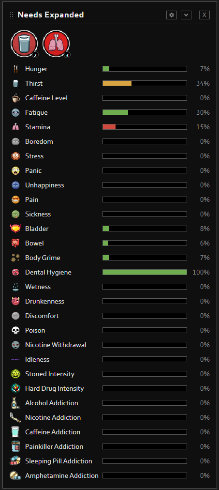
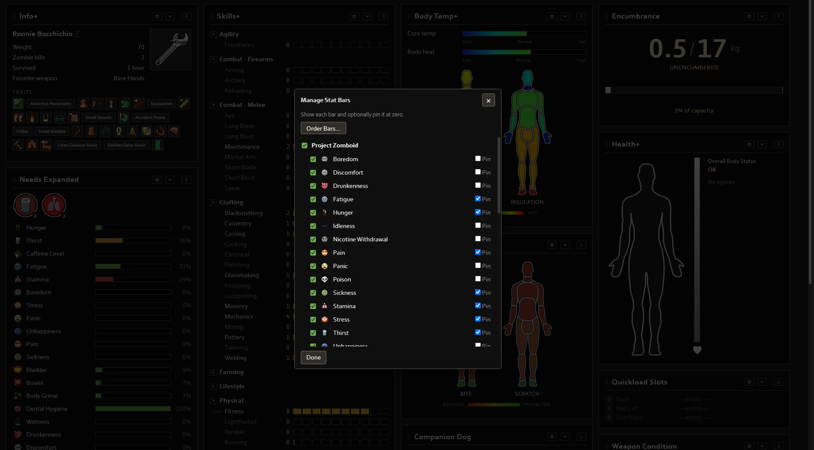
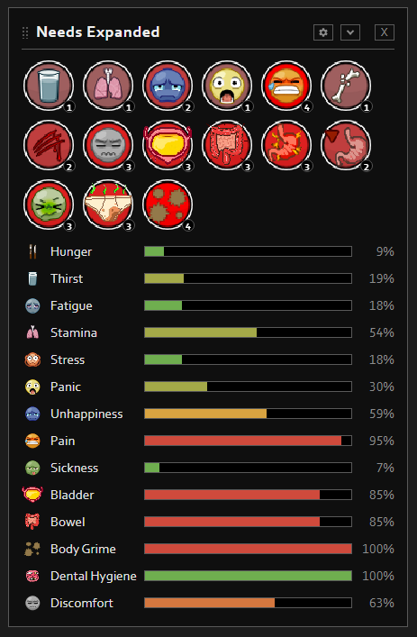
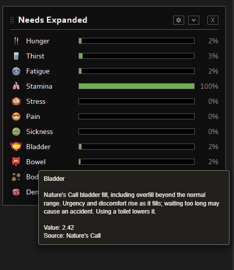
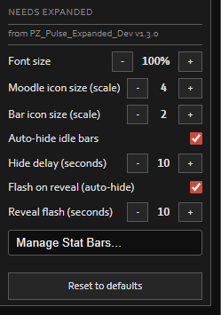

# PZ Pulse Expanded

[h1]ONE DASHBOARD. MORE OF YOUR CHARACTER.[/h1]

See your survivor's needs, hidden vanilla stats, and active modded moodles together in [b]Needs Expanded[/b] — a replacement for PZ Pulse's Moodles & Needs+ panel, built for Project Zomboid Build 42.

[b]Requires [url=https://steamcommunity.com/sharedfiles/filedetails/?id=3753700423]PZ Pulse[/url].[/b] Load PZ Pulse Expanded after PZ Pulse, then restart the game after changing your mod list. Supported integrations are optional.

[h2]NEEDS EXPANDED: YOUR SURVIVOR AT A GLANCE[/h2]

See familiar Needs+ bars alongside active moodles and extra player-state meters. Needs Expanded also surfaces vanilla [b]Discomfort[/b] and stats that the original panel doesn't show.

[h2]CHOOSE WHAT YOU SEE[/h2]

Use [b]Manage Stat Bars[/b] to show or hide individual bars or whole sources, pin bars, and change their order. Choices for unavailable sources stay saved for when you enable those mods later.

[h2]OPTIONAL MOD MOODLES AND METERS[/h2]

Supported mods can add active moodles and optional meters such as Bladder, Bowel, Hygiene Need, Body Grime, Dental Hygiene, addictions, drug intensity, and Caffeine Level. No integration is required. Rows appear only when their source is active and its data is available.

[h2]KNOW WHAT A STAT MEANS[/h2]

Hover for a short description, current value, and source. Modded stats identify the mod their data comes from.

[h2]Adjust Things As You See Fit![/h2]

Set separate moodle and bar icon sizes, hide idle bars after a delay, and flash a bar when it reappears. Bars where low values are beneficial can auto-hide; pinned bars stay visible. Stamina and Dental Hygiene remain visible at zero.

[h2]Too Many Stats Cluttering Your Screen? Auto Hide Has You Covered![/h2]

[Auto-hide and reveal-flash GIF slot: upload the GIF and replace GIF_AUTO_HIDE_FLASH_URL in workshop.txt.]

[h2]COMPATIBILITY[/h2]

[list]
[*]Made for Project Zomboid Build [b]42.20+[/b].
[*][b]PZ Pulse is the only required mod.[/b]
[*]In multiplayer, only state available locally or synchronized by the source mod can be shown. Match client and server mod lists and versions when a server-side source mod is involved.
[*]If an optional mod stat isn't available. It just doesn't show.
[/list]

[h2]THIRD-PARTY ARTWORK[/h2]

This add-on includes moodle glyphs from supported mods so their states can appear with familiar in-game artwork. PZ Pulse's vanilla glyphs and colored moodle circles are reused at runtime. Artwork remains the property of its creators; no ownership is claimed. Copied glyphs come from Lifestyle: Hobbies (3403870858), Take A Bath And Shower (3592172476), Infirmities (3579088411), Medicine Moodles (3778856579), Brush Your Damn Teeth (3794105078), The Mutants (3796669056), DrugTime 89 (3632964785), and Nature's Call (3709126801). Mod authors or rights holders can contact me to request removal.

[h2]CURRENT FEATURES[/h2]

This release focuses on [b]Needs Expanded[/b]. The plans below are future work and are not included as completed features in the current release.

[h2]FUTURE PLANS[/h2]

[list]
[*][b]Info Expanded:[/b] Add support for modded traits in PZ Pulse's Info+ panel.
[*][b]Skills Expanded:[/b] Add support for traits as skills and skill levels beyond 10 in PZ Pulse's Skills+ panel.
[/list]

[h2]FEATURE REQUESTS AND BUG REPORTS[/h2]

I’ll set up separate pinned Workshop discussion threads for feature requests and bug reports. Please use the matching thread to keep feedback organized. For a bug report, include your Project Zomboid build, mod versions, steps to reproduce, and relevant logs or screenshots. For a feature request, describe the problem and the outcome you’d like.

Back up important saves before changing a mod list.

Generative AI was used to aid in development of this mod.
